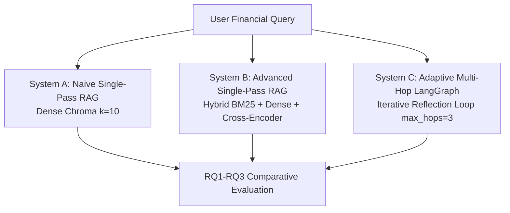
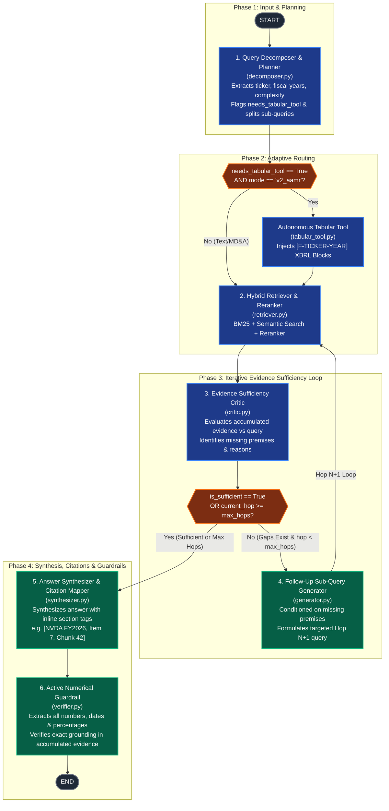

# System C Architecture Specification & State Graph

**Current Version:** v1.0 (Milestone 1 State)  
**System Name:** Adaptive Multi-Hop Retrieval-Augmented Generation (AMR & AAMR)  
**Target Domain:** SEC Form 10-K Financial Disclosures & Footnotes  
**Core Modules:** Planning & Sufficiency Reflection (RQ3), Evidence Retrieval & Chaining (RQ1), Citation Mapping & Numerical Guardrail (RQ2)  

---

## 1. High-Level System Triad Context

In this research project, we benchmark three competing architectural paradigms on complex financial queries:



---

## 2. System C Detailed LangGraph State Machine (v1 AMR & v2 AAMR)

System C is implemented as a cyclical state machine using LangGraph (`src/system_c/graph.py`). It supports two runtime modes:
- **`v1_amr` (Adaptive Multi-Hop RAG):** Dynamic evidence reflection loop up to 3 hops.
- **`v2_aamr` (Agentic Adaptive Multi-Hop RAG):** Adds autonomous pre-routing to deterministic XBRL tabular lookup (`data/financials.csv`) for quantitative queries.



---

## 3. Node Specifications & Division of Responsibilities

| Node Name | Module Path | Focus Area | Inputs from State | Outputs to State | Research Question Impact |
| :--- | :--- | :---: | :--- | :--- | :--- |
| **`decomposer`** | [`src/system_c/nodes/decomposer.py`](file:///Users/anishdobz/projects/cs614_group8/src/system_c/nodes/decomposer.py) | **Planning & Decomposition** | `original_query` | `target_ticker`, `fiscal_years`, `query_complexity`, `needs_tabular_tool`, `sub_queries`, `current_sub_query` | RQ3 (early complexity detection) |
| **`tabular_tool`** | [`src/system_c/tools/tabular_tool.py`](file:///Users/anishdobz/projects/cs614_group8/src/system_c/tools/tabular_tool.py) | **Deterministic Financials** | `target_ticker`, `fiscal_years` | `tabular_evidence`, `accumulated_evidence` (`[F-<ticker>-<year>]`) | RQ2 (zero-hallucination XBRL figures) |
| **`retriever`** | [`src/system_c/nodes/retriever.py`](file:///Users/anishdobz/projects/cs614_group8/src/system_c/nodes/retriever.py) | **Hybrid Evidence Retrieval** | `current_sub_query`, `target_ticker`, `fiscal_years` | `accumulated_evidence` (appended & deduplicated) | RQ1 (Retrieval Recall & Non-adjacent sections) |
| **`critic`** | [`src/system_c/nodes/critic.py`](file:///Users/anishdobz/projects/cs614_group8/src/system_c/nodes/critic.py) | **Sufficiency Reflection** | `original_query`, `accumulated_evidence`, `current_hop` | `is_sufficient`, `missing_premises`, `critic_reasoning`, `intermediate_answers` | RQ3 (Early-Stopping & Cost Reduction) |
| **`generator`** | [`src/system_c/nodes/generator.py`](file:///Users/anishdobz/projects/cs614_group8/src/system_c/nodes/generator.py) | **Conditioned Sub-Query Generation** | `original_query`, `accumulated_evidence`, `missing_premises` | `current_sub_query`, `current_hop`, `sub_queries` | RQ1 (Hop Attribution & Clue Chaining) |
| **`synthesizer`** | [`src/system_c/nodes/synthesizer.py`](file:///Users/anishdobz/projects/cs614_group8/src/system_c/nodes/synthesizer.py) | **Synthesis & Citation Mapping** | `original_query`, `accumulated_evidence`, `tabular_evidence` | `draft_answer`, `final_answer`, `citations` | RQ2 (Inline Citation Grounding) |
| **`guardrail`** | [`src/system_c/guardrails/verifier.py`](file:///Users/anishdobz/projects/cs614_group8/src/system_c/guardrails/verifier.py) | **Numerical Guardrail Verification** | `draft_answer`, `accumulated_evidence` | `final_answer`, `guardrail_passed`, `guardrail_report` | RQ2 (Numerical Grounding Error Rate) |

---

## 4. Central LangGraph State Schema (`AdaptiveRAGState`)

All nodes communicate through a shared immutable state contract defined in [`src/system_c/state.py`](file:///Users/anishdobz/projects/cs614_group8/src/system_c/state.py):

```python
class AdaptiveRAGState(TypedDict):
    # Input & Entity Filtering
    original_query: str
    mode: str                           # "v1_amr" | "v2_aamr"
    target_ticker: Optional[str]        # e.g. "NVDA", "AAPL"
    target_pairs: List[List[Any]]       # [[ticker, year], ...]
    fiscal_years: List[int]

    # Planning
    query_complexity: str               # "single_hop" | "multi_hop"
    sub_queries: List[str]
    current_sub_query: str
    needs_tabular_tool: bool            # v2 AAMR flag

    # Evidence Accumulation
    accumulated_evidence: List[EvidenceChunk]
    tabular_evidence: List[str]         # [F-<ticker>-<year>] blocks
    intermediate_answers: List[Dict[str, Any]]

    # Reflection & Loop Control
    current_hop: int                    # 1, 2, or 3
    max_hops: int                       # Ceiling = 3
    force_max_hops: bool                # RQ3 ablation flag
    is_sufficient: bool                 # Critic decision
    missing_premises: List[str]         # Passed to Generator
    critic_reasoning: str

    # Output & Verification
    draft_answer: Optional[str]
    final_answer: Optional[str]
    citations: List[CitationRecord]
    guardrail_passed: bool
    guardrail_report: Dict[str, Any]    # RQ2 metrics

    # RQ3 Telemetry
    telemetry: Dict[str, Any]           # Token consumption, node latency, USD cost
```

---

## 5. Architectural Evolutions (Changelog & Versioning)

- **v1.0 (24 Oct 2026):**
  - Initial LangGraph state machine implementation.
  - Query Decomposer with single-hop early classification.
  - Evidence Sufficiency Critic with dynamic early stopping (`is_sufficient`).
  - Conditioned Hop N+1 generator.
  - Synthesizer with inline citations and regex-based numerical guardrail verifier.
  - Autonomous `tabular_tool` integration (`v2_aamr`) for XBRL `financials.csv` tables.
  - Automated RQ3 telemetry wrapper (`call_llm`) recording latency, tokens, cost, and hop distribution.
- **Upcoming Enhancements:**
  - Advanced citation mapper and multi-number cross-verification.
  - Live vector database hook to baseline Chroma vector store (`chroma_db/`).
  - Standardized multi-company benchmark evaluation.
