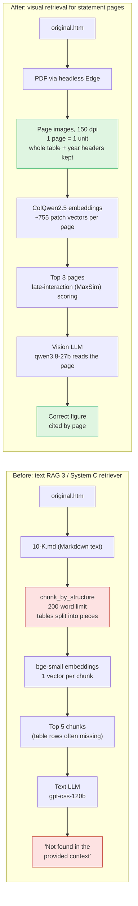
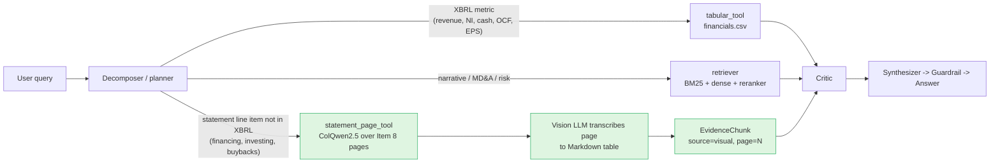

# Table chunking and visual retrieval: findings

**Owner:** Xavier · **Date:** 2026-10-26 · **Status:** final for this round. Retrieval tested on 10 companies; vision-model answers run on MSFT/NVDA only (16 remaining questions not run)

## TL;DR

- Table splitting is a **retrieval** problem, not only a chunking one: for most failing questions the
  right table row never reaches the LLM.
- Page-image retrieval with **ColQwen2.5** fixes it: it put the page holding the answer in its top 3
  for **19 of 20** questions, and answered **4/4** correctly in the full run (text RAG: **0/4**).
- The original **ColPali v1.3** is not good enough on dense financial pages (1/4).
- Recommendation: add visual retrieval to **System C v2 as a tool for financial statement pages only**,
  not as a replacement for text RAG. That fits the Supabase free tier with binary-quantized vectors.

## 1. The problem

Aryan found tables split mid-chunk (e.g. the Microsoft cash flow statement missing the net cash rows).
The cause is `split_table` in `chunk_by_structure` (`build_vdb_base_RAG.ipynb`, and copied into
`src/system_c/corpus.py` on `dev`): any Markdown table over **200 words** is cut into row groups.

| Measure (all `.md` filings) | Count |
|---|---|
| Tables | 20,740 |
| Split at 200 words | **6,132 (30%)** |
| Over 1,000 words | 87 |

Two things break when a table is split:

1. **Rows are separated** from the statement title and section, so the piece holding "Net change in cash"
   rarely ranks in the top 5.
2. **Year headers can be lost.** In MSFT FY2025 the last piece repeats only `| (In millions) |`; the
   `2025 | 2024 | 2023` row stayed in the first piece, so the model sees three numbers with no years.

## 2. What changed in the pipeline



Proposed fit inside System C v2 (the new parts are green):



## 3. Experiment

Questions target rows in the **later pieces** of split cash flow tables, in the latest 10-K of each company.
Every system searches only within the correct filing (same as the ticker + fiscal year filter).

| | Text RAG 3 (before) | Control | Visual RAG (after) |
|---|---|---|---|
| Input | `10-K.md` | `10-K.md` | `original.htm` printed to PDF |
| Retrieved | top 5 chunks | same | top 3 pages |
| Retriever | `BAAI/bge-small-en-v1.5` | same | `vidore/colqwen2.5-v0.2` |
| Answer model | `openai/gpt-oss-120b` | `qwen/qwen3.8-27b` | `qwen/qwen3.8-27b` (images) |

The **control** uses the same answer model as visual RAG, so the difference between them comes from retrieval.

## 4. Results

### 4a. Full three-way run: MSFT and NVDA (4 questions)

| Question | Expected ($M) | Text RAG 3 (gpt-oss) | Control (Qwen, text) | ColQwen2.5 + Qwen |
|---|---|---|---|---|
| MSFT FY2025 net change in cash | 11,927 | ✗ | ✗ | ✓ |
| MSFT FY2025 net cash used in investing | 72,599 | ✗ | ✗ | ✓ |
| NVDA FY2026 net cash used in financing | 48,474 | ✗ | ✗ | ✓ |
| NVDA FY2026 cash at end of period | 10,605 | ✗ | ✗ | ✓ |
| **Total** | | **0/4** | **0/4** | **4/4** |

Every text run replied "Not found in the provided context."

### 4b. Choice of visual retriever matters

Rank of the page that holds the answer:

| Question | ColPali v1.3 | ColQwen2.5 |
|---|---|---|
| MSFT net change in cash | 48 of 137 | **1** |
| MSFT investing | 22 | **1** |
| NVDA financing | 1 | **1** |
| NVDA end-of-period cash | 18 | **1** |
| End-to-end correct | 1/4 | **4/4** |

### 4c. Ten companies (20 questions)

| Ticker | Question | Expected ($M) | Text RAG 3 answer | Row in top-5 chunks? | ColQwen2.5 rank of answer page |
|---|---|---|---|---|---|
| MSFT | Net change in cash | 11,927 | "$28.1 billion" ✗ | no | 1 |
| MSFT | Net cash used in investing | 72,599 | Not found ✗ | no | 1 |
| NVDA | Net cash used in financing | 48,474 | Not found ✗ | no | 1 |
| NVDA | Cash at end of period | 10,605 | Not found ✗ | no | 1 |
| AAPL | Cash used in financing | 120,686 | Not found ✗ | no | 1 |
| AAPL | Repurchases of common stock | 90,711 | "$89.3 billion" ✗ | no | 1 |
| AMZN | Net cash from financing | 9,661 | "$9.7 billion" ✓ | no | 1 |
| AMZN | Cash + restricted cash, end of year | 90,106 | Not found ✗ | no | 1 |
| GOOGL | Net cash used in financing | 37,388 | Not found ✗ | no | 1 |
| GOOGL | Cash at end of period | 30,708 | Not found ✗ | no | 1 |
| JNJ | Net cash used in financing | 5,539 | Not found ✗ | no | 3 |
| JNJ | Cash at end of year | 19,709 | "$19.7 billion" ✓ | yes | 3 |
| JPM | Net cash from financing | 269,533 | Not found ✗ | no | 2 |
| JPM | Cash and deposits with banks, end | 343,338 | Not found ✗ | no | 1 |
| META | Repurchases of Class A stock | 26,248 | "$26.26 billion" ✗ | no | 6 |
| META | Net cash used in financing | 20,370 | "$20.37 billion" ✓ | yes | 1 |
| TSLA | Net cash from financing | 1,139 | "$1.139 billion" ✓ | yes | 1 |
| TSLA | Cash + restricted cash, end of year | 17,616 | "$17.616 billion" ✓ | yes | 1 |
| WMT | Net cash used in financing | 13,553 | Not found ✗ | no | 1 |
| WMT | Cash + restricted cash, end of year | 11,321 | Not found ✗ | no | 1 |
| **Total** | | | **5/20** | **4/20** | **top-1: 16/20 · top-3: 19/20** |

Vision-model answers (and the Qwen control) for the 16 new questions were **not run**: the first attempt hit
Groq's 200k tokens/day limit for `qwen/qwen3.8-27b`. Page embeddings for all 10 filings are cached, so the
rerun only costs the answer calls. Text RAG is graded with rounding allowed: "$19.7 billion" counts for 19,709, "$26.26 billion" does not count for 26,248.

### 4d. Normal (narrative) questions: retrieval only

Is visual retrieval worse outside the table edge case? Ten narrative questions, one per company
(risk, operations, segments, legal, regulation, headcount). A chunk or page counts as a hit if it contains a
gold phrase from the answer passage. No LLM calls, so this measures retrieval, not answer quality.

| Filing | Question | Text RAG 3: rank of first gold chunk | ColQwen2.5: rank of first gold page |
|---|---|---|---|
| NVDA | How have U.S. export controls affected NVIDIA's ability to sell? | 3 of 474 | 2 of 113 |
| MSFT | How many people did Microsoft employ as of June 30, 2025? | 3 of 486 | 1 of 137 |
| AAPL | Where is Apple's manufacturing performed? | **33** of 330 | 3 of 77 |
| AMZN | How many employees did Amazon have at the end of 2025? | **13** of 409 | 1 of 119 |
| GOOGL | How does the EU Digital Markets Act affect Alphabet? | 1 of 527 | 1 of 156 |
| JNJ | How is J&J trying to resolve the talc claims? | 4 of 608 | 2 of 130 |
| JPM | What stress testing framework does the Fed apply to JPMorgan? | 2 of 1,661 | 2 of 479 |
| META | What are Meta's reportable segments? | 1 of 649 | 1 of 215 |
| TSLA | What is Tesla's Cortex AI training cluster? | 1 of 532 | 1 of 159 |
| WMT | How many associates does Walmart employ? | 1 of 485 | 1 of 123 |
| **Total** | | top-1: 4/10 · in top 5: **8/10** | top-1: 6/10 · in top 3: **10/10** |

Visual retrieval was **not worse** on these questions, and found the passage in two cases text RAG 3 missed
(Apple manufacturing at rank 33, Amazon headcount at rank 13). Read this with care:

- **Pages are bigger units.** A filing has about 3–4 chunks per page, so 3 pages hold roughly as much text as
  10–12 chunks, and a hit is easier. Top-5 chunks vs top-3 pages is not an equal amount of context.
- **Retrieval only.** Whether the vision model then answers narrative questions as well as a text model
  reading clean chunks was not tested; long passages spread over several pages may suffer.
- **Ten easy, single-passage questions.** Multi-section and multi-year questions were not covered.

### 4e. Group benchmark (FY2025+ questions)

On the 5 questions in `benchmark_qa_0.jsonl` that use FY2025+ filings: text RAG 3 **2/5**, visual RAG
**4/5 + 1 partial**. Visual RAG won all 3 table questions; text RAG 3 was as good or better on the 2 text-only
ones. Details in [benchmark/BENCHMARK.md](benchmark/BENCHMARK.md).

## 5. Findings

1. **The failure is retrieval.** In 16 of 20 questions the correct row was never in the top-5 text chunks.
   MD&A narrative ("Cash from operations increased $17.6 billion...") outranks table pieces.
2. **Text answers can be confidently wrong**: e.g. MSFT "$28.1 billion" and AAPL "$89.3 billion",
   taken from other passages. That is worse than "Not found".
3. **Whole pages keep table structure.** The rendered statement page has its title, year headers and every
   row, and the vision model reads the right column.
4. **The retriever is the key choice.** ColQwen2.5 ranks the right page first in 16/20 questions;
   ColPali v1.3 was unreliable.
5. **The same bug exists in System C.** `src/system_c/corpus.py` (on `dev`) copies `_split_table` with a
   200-word limit, and the XBRL `tabular_tool` covers only 9 metrics, none of them financing, investing or buybacks.
6. **On normal questions visual retrieval held up** (10/10 in top 3 pages vs 8/10 in top 5 chunks), so it is
   not only an edge-case tool, but the comparison favours pages (more text per unit) and answer quality was
   not measured. Its case rests on robustness and tables; its cost (GPU, storage, vision model) still argues for
   routing rather than replacing text RAG.
7. **Graph-based chunking (GraphRAG) would not fix this.** It extracts entity relationships, not tables of
   numbers. The useful part of the idea is linking a table's pieces so the whole table is returned
   (parent-document retrieval).

## 6. Limitations

- 20 hand-picked questions on the latest filing per company, all aimed at the failure mode. Not tested on
  narrative questions, where text RAG is likely as good or better.
- Two things change at once versus the gpt-oss baseline (retriever and answer model); the Qwen control
  isolates retrieval on 4 questions so far.
- **Cost:** ~190 KB of vectors per page (755 × 128, bf16), a GPU to index (RTX 3080 Ti: minutes per few
  hundred pages), and a vision model to answer. Only `qwen/qwen3.8-27b` accepts images on Groq.
- A table that spans two pages is still split, at the page break.
- Page layout comes from printing the HTML, not the official PDF. Pre-2001 plain-text filings gain little.
- For 16 of 20 questions only retrieval was measured, not the final vision-model answer.

## 7. Storage on the Supabase free tier (500 MB database, 1 GB file storage)

| Scope | Pages | Raw bf16 | Binary-quantized (~12 KB/page) |
|---|---|---|---|
| Every page of every filing | ~115k | ~22 GB ❌ | ~1.4 GB ❌ |
| Latest filing per company | 1,708 | 330 MB ⚠️ | ~20 MB ✅ |
| **Item 8 statement pages only** | ~5k | ~1 GB ❌ | **~65 MB ✅** |

Store one file (or `bytea` row) per filing, keyed by ticker and year. pgvector cannot do multi-vector
MaxSim scoring, but System C already filters to one filing, so scoring ~6 pages in Python takes milliseconds.

## 8. How to proceed

1. **Optional: finish the 20-question answers** with `run_eval.py` (stages are cached; it waits out Groq limits).
2. **Check binary quantization** keeps the 19/20 top-3 retrieval result.
3. **Add `statement_page_tool` to System C v2:**
   - index only Item 8 statement pages (detect by title: "Cash Flows", "Balance Sheets", "Income Statements"),
   - route sub-queries for statement line items not in XBRL to it,
   - have the vision model transcribe the page to a Markdown table and return it as an `EvidenceChunk`
     (`source="visual"`, `page=N`) so the critic, citations and guardrail work unchanged,
   - log cost and latency with `track_node_latency` for RQ3.
4. **Run the ablation** on the table questions in the 60-question golden set
   (`feature/golden-dataset-eval`): System C v2 vs v2 + `statement_page_tool`.
5. **Cheap complement for text RAG:** keep each table whole up to ~1,000 words, or return the full table
   when any piece is retrieved. This improves Systems A and B too, at almost no cost.
6. **Report framing:** "ColPali-style visual late-interaction retrieval (ColQwen2.5)" as a targeted tool for
   financial statements, with ColPali v1.3 as the weaker variant and the storage and GPU costs above
   as the reason it is not used for the whole corpus.

## Reproduce

```
.venv/Scripts/python colpali_eval/run_eval.py                          # three-way run; writes results.md/json
.venv/Scripts/python colpali_eval/diagnose.py vidore/colqwen2.5-v0.2   # answer-page ranks
```

Needs `GROQ_API_KEY` in `.env`, CUDA PyTorch, `colpali-engine`, `pypdfium2` (see `README.md` here).
