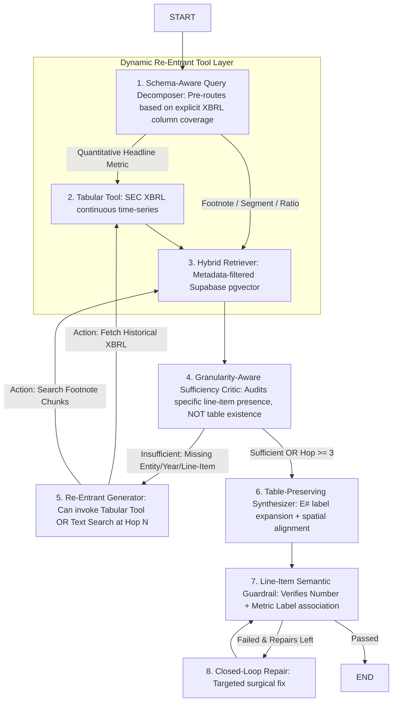

# System C v3 Specification: Adaptive Agentic Multi-Hop with Semantic Grounding (AAMR-SG)

**Module:** System C Architectural Evolution (v3)  
**Branch:** `feature/system-c-adaptive-rag`  
**Base Commit:** `dev` @ `ca024e6`  
**Target Milestone:** Peak Benchmark Accuracy ($\ge 93\%$) + Sub-15s Median Latency  
**Author:** Anish (System C Architecture Lead)  
**Date:** October 31, 2026  

---

## 1. Executive Motivation: Why System C v3?

In our 97-question benchmark ($\ge$ FY2015 across Apple, Amazon, Google, Microsoft, NVIDIA, Tesla, and Walmart):
* **System C v1 (AMR):** Reached **89.66% accuracy**, but suffered from slow latency ($p50 = 21.4\text{s}$) and failed the 10-K "Lookback Barrier" (`gold-066` Tesla FY21 vs. FY25 total assets) because single SEC 10-K filings only report the prior two fiscal years.
* **System C v2 (AAMR):** Introduced continuous SEC XBRL financial statements (`financials.csv` / Supabase `sec_financials`), slashing median latency by **36.7%** ($p50 = 13.6\text{s}$) and resolving `gold-066` in **1 single hop** (8.4s). However, overall benchmark accuracy dropped to **82.76%**.
* **The Root Cause:** In 9 questions requiring granular footnote disclosures (e.g. `gold-073` NVIDIA Gross Margin, `gold-037` Tegra Processor segment revenue, `gold-003` Microsoft Finland assets, `gold-091` Amazon debt maturity schedules), the presence of macro balance sheet tables (`[F-...]`) caused the Evidence Sufficiency Critic to terminate prematurely at Hop 1, missing the granular Item 8 footnotes that System C v1 discovered in Hops 2 and 3.

**System C v3 (`mode="v3_aamr_sg"`)** resolves this trade-off by upgrading the pipeline with **schema-aware tool routing**, **granularity-aware sufficiency reflection**, and **re-entrant multi-hop tool execution**.

---

## 2. Core Architectural Upgrades in System C v3



### Upgrade 1: Schema-Aware Query Decomposer (`src/system_c/nodes/decomposer.py`)
* **Problem in v2:** Flags `needs_tabular_tool = True` whenever a query mentions words like `"margin"`, `"debt"`, or `"revenue"`, even if the requested metric is *not* in `financials.csv`.
* **V3 Solution:** Match incoming queries against the explicit 10-column XBRL schema:
  ```python
  XBRL_CORE_METRICS = {
      "revenue": ["revenue", "sales", "turnover"],
      "net_income": ["net income", "net earnings", "profit"],
      "operating_income": ["operating income", "operating profit", "ebit"],
      "total_assets": ["total assets"],
      "total_liabilities": ["total liabilities"],
      "stockholders_equity": ["stockholders equity", "shareholders equity", "book value"],
      "cash_and_equivalents": ["cash and cash equivalents", "cash balance"],
      "operating_cash_flow": ["operating cash flow", "cash from operations", "ocf"],
      "eps_diluted": ["diluted eps", "earnings per share"]
  }
  ```
* If the query asks for a metric *outside* this set (e.g., Gross Margin, Tegra Processor revenue, Geographic assets, Debt maturity schedules), `needs_tabular_tool` remains `False`, routing the query directly to hybrid document retrieval.

### Upgrade 2: Granularity-Aware Sufficiency Critic (`src/system_c/nodes/critic.py`)
* **Problem in v2:** Lines 186–207 override the sufficiency score to `0.95` whenever tabular evidence is present, unless the query matches a crude negative keyword list (`has_narrative_need`).
* **V3 Solution:** Eliminate the hardcoded negative keyword heuristic. Replace it with **Explicit Target Metric Verification**:
  ```python
  # Only allow early stopping if the query specifically targets a metric present in the XBRL column schema
  is_target_in_xbrl = any(
      any(alias in query.lower() for alias in aliases)
      for metric, aliases in XBRL_CORE_METRICS.items()
  )
  if is_target_in_xbrl and is_xbrl_covered:
      score = max(score, 0.95)
  else:
      # Keep the LLM Critic's organic score; do NOT override to 0.95
      score = parsed_llm_score
  ```
* If the question asks for a footnote disclosure, the Critic correctly rates sufficiency $\le 0.60$, forcing the state machine to continue into Hops 2 and 3.

### Upgrade 3: Re-Entrant Tool Actions in Generator & Graph (`graph.py` & `nodes/generator.py`)
* **Problem in v2:** `tabular_tool_node` can only run before Hop 1. If Hop 2 uncovers a new competitor or past year, the graph cannot call `tabular_tool`.
* **V3 Solution:** `generator_node` can return an explicit action:
  * `target_action = "call_tabular"` (with resolved ticker & fiscal years).
  * `target_action = "retrieve_text"` (with conditioned search sub-query).
* The LangGraph router dynamically branches `generator -> tabular_tool -> retriever` or `generator -> retriever`.

### Upgrade 4: Line-Item Semantic Association Guardrail (`guardrails/verifier.py`)
* **Problem in v2:** `_match_number_in_chunks` checks only if the numeric string exists in the chunk, ignoring whether it was attached to the correct line item.
* **V3 Solution:** For each verified number, verify that the metric label in the answer sentence (e.g., *"Operating Income"*) semantically matches the surrounding text window ($\pm 15$ words) of the number in the source table/text chunk.

---

## 3. Data Contracts & State Machine Updates

### State Schema Changes (`src/system_c/state.py`):
```python
class AdaptiveRAGState(TypedDict, total=False):
    # Existing fields preserved...
    mode: Literal["v1_amr", "v2_aamr", "v3_aamr_sg"]  # Added v3 mode
    target_metric_type: Literal["xbrl_headline", "footnote_disclosure", "hybrid"]
    last_action: Literal["tabular_tool", "retriever", "none"]
```

### Routing Function in `graph.py`:
```python
def route_after_decomposer(state: AdaptiveRAGState) -> Literal["tabular_tool", "retriever"]:
    mode = state.get("mode")
    if mode in ("v2_aamr", "v3_aamr_sg") and state.get("needs_tabular_tool"):
        return "tabular_tool"
    return "retriever"

def route_after_critic(state: AdaptiveRAGState) -> Literal["generator", "synthesizer"]:
    hop = state.get("current_hop", 1)
    max_hops = state.get("max_hops", 3)
    if state.get("is_sufficient") or hop >= max_hops:
        return "synthesizer"
    return "generator"
```

---

## 4. Verification Protocol (Smoke Tests & Benchmarks)

1. **Unit Test Suite:**
   * Run `pytest tests/test_system_c.py -v` (ensure all existing contracts pass).
2. **Single-Query Smoke Test (`gold-073`):**
   * Query: NVIDIA Gross Margin increase from FY2016 to FY2022.
   * *Target Behavior:* System C v3 must **not** early-stop at Hop 1; must execute 2 hops and answer **8.8 percentage points** correctly.
3. **Two-Query Dual-Path Smoke Test (`gold-066` + `gold-073`):**
   * `gold-066`: Tesla FY21 vs FY25 Total Assets (Macro Time-Series) $\rightarrow$ Must early-stop at Hop 1 via XBRL.
   * `gold-073`: NVIDIA Gross Margin (Footnote) $\rightarrow$ Must continue to Hop 2 and retrieve Item 7 text chunks.
4. **Full 97-Question Benchmark:**
   * Run `python -m scripts.rq3.run_rq3_experiment --systems system_c_v3 --benchmark data/benchmark_qa_pool_2015.json`.
   * Compare head-to-head with `system_c_v1` and `system_c_v2` in `reports/rq3/summary_metrics.json`.
