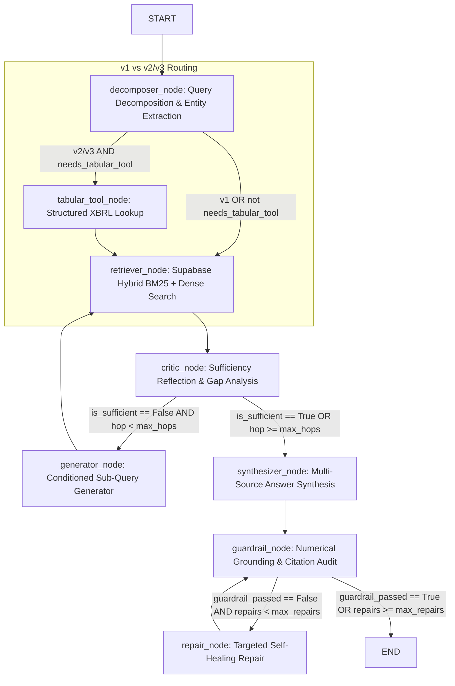
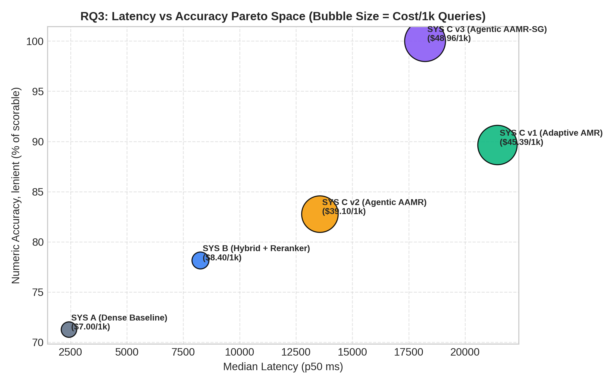

# Adaptive Multi-Hop Reasoning & Inference Economics for Complex SEC 10-K Financial Disclosures

**Course:** CS614: Generative AI with Large Language Models (August Term 2026)  
**Group:** Group 8  
**Institution:** Singapore Management University (SMU)  
**Authors:** Anish (System C Architecture & RQ3 Lead), Aryan (Citations, Guardrails & RQ2 Lead), Kevin (RQ2 Evaluation), Amanda (System A Baseline & Benchmark Lead), Xavier (System B & ColPali Lead)  
**Date:** November 2026  
**Primary Artifact:** `reports/CS614_Group8_System_C_and_RQ3_Final_Report.docx` (generated from this file by `scripts/build_word_report.py`)  

---

## 1. Executive Summary & Problem Motivation

Corporate financial analysis requires audit-grade question answering over United States Securities and Exchange Commission (SEC) Form 10-K annual filings. Unlike standard open-domain or encyclopedic corpora, enterprise financial disclosures present structural characteristics that routinely defeat naive single-pass Retrieval-Augmented Generation (RAG):

1. **Cross-Section Information Separation:** Critical premises are separated across distant, non-contiguous items. Evaluating credit risk or solvency requires synthesizing risk narratives in Item 1A, liquidity commentary in Item 7 (Management's Discussion & Analysis), and multi-year debt maturity schedules in the Item 8 footnotes.
2. **Dense Semantic Embedding Collapse:** Dense bi-encoder embeddings often fail to distinguish closely related accounting terms, such as *operating lease commitments* versus *finance lease liabilities*, or *total company revenue* versus *segment revenue*.
3. **High Asymmetric Error Liability:** In investment banks, credit rating agencies and compliance desks, a wrong or hallucinated figure carries economic and regulatory consequences far larger than the cost of computing the answer.

This study develops and benchmarks five RAG configurations (System A, System B, System C v1, v2 and v3) on an audited **97-question financial benchmark** (FY2015 onwards) covering ten companies: Apple, Amazon, Alphabet, Microsoft, NVIDIA, Tesla, Walmart, Meta, Johnson & Johnson and JPMorgan Chase. Every system answered every question, giving **485 evaluated runs** (97 × 5). We ask: **does dynamic, multi-hop agentic reasoning justify its latency and dollar cost over single-pass RAG, and where is the operational Pareto frontier?**

---

## 2. Team Responsibility & Attribution Matrix

In line with the course assessment policy requiring individual documentation of member contributions, Table 1 sets out module ownership across Group 8:

| Team Member | Core Engineering Modules | Primary Research Scope | Deliverables Owned |
| :--- | :--- | :--- | :--- |
| **Anish (Lead)** | LangGraph State Machine, Hybrid Retriever, XBRL Tabular Tool, Telemetry Wrapper, Benchmark Runner | System C Architecture & RQ3 (Inference Economics) | Graph Orchestration, Decomposer, Tabular Tool, Ablation Suite, Cost & Latency Pareto Models |
| **Aryan** | Conditioned Query Generator, Synthesizer, Citation Mapper, Numerical & Semantic Guardrail, Repair Node | System C Citations & RQ2 (Faithfulness & Grounding) | `generator.py`, `synthesizer.py`, `verifier.py`, `repair.py`, RAGAS & Custom Citation Evaluation Harness |
| **Kevin** | RQ2 Evaluation Harness | RQ2 (Faithfulness & Grounding), with Aryan | RQ2 scoring runs and analysis |
| **Amanda** | System A Baseline (Dense Chroma/Supabase), Benchmark Curation (97 QAs), Anti-Leakage Firewalls | System A Architecture & RQ1 Starter Skeleton | Vanilla RAG pipeline, SEC filings ingestion, gold QA generation and manual validation |
| **Xavier** | System B Pipeline (BM25 + BGE Reranker), ColPali Visual Embeddings Evaluation | System B Architecture & RQ1 (Cross-Section Retrieval) | Hybrid retrieval fusion, Cross-Encoder reranker integration, ColPali evaluation notebooks (separate experiment, not part of System B) |

---

## 3. System Architecture & Comparative Topology

We evaluate five system configurations over an identical corpus of **95,044 chunks** from **272 filings**, indexed into Supabase PostgreSQL (`sec_chunks`) using 384-dimensional `bge-small-en-v1.5` embeddings:

* **System A (Vanilla Dense Baseline):** Single-pass dense semantic retrieval (k = 10) followed by direct synthesis with OpenAI `gpt-5.4`.
* **System B (Advanced Single-Pass Hybrid):** Sparse BM25 and dense cosine scores are min-max normalised and combined by weighted fusion (α = 0.5). The top 30 fused candidates are reranked by the `bge-reranker-large` cross-encoder. The top 5 reranked chunks, plus up to 5 further distinct dense matches (**10 chunks** in total), are passed to the generator, whose prompt asks it to show the inputs to any calculation and to answer the supported parts of a multipart question.
* **System C v1 (Adaptive Multi-Hop RAG, AMR):** A LangGraph state machine with query decomposition, hybrid retrieval, evidence-sufficiency reflection, follow-up sub-query generation (up to 3 hops), inline citation mapping, a numerical guardrail and self-healing repair.
* **System C v2 (Agentic Adaptive Multi-Hop RAG, AAMR):** Extends v1 by routing quantitative questions to structured SEC XBRL financials (`financials.csv` / Supabase `sec_financials`) before document retrieval, so headline figures can be answered in one hop.
* **System C v3 (AAMR with Schema-Aware Sufficiency, AAMR-SG):** Keeps the v2 XBRL fast path but only for headline metrics, and adds:
  - schema-aware pre-routing (`is_xbrl_headline_target`): footnote, segment and margin questions skip the XBRL shortcut;
  - line-item (granularity-aware) sufficiency checks in the Critic, so XBRL totals no longer count as sufficient evidence for footnote-level questions;
  - structural table-boundary stitching in the retriever, which re-joins markdown tables split across chunk boundaries;
  - temporal role disambiguation in the decomposer, separating the filing year from contractual maturity years (e.g. "due in 2020" in an FY2019 10-K);
  - per-ticker search isolation for multi-company comparison questions;
  - a time-series consistency rule in the synthesizer for multi-year comparisons that use restated figures.

In v3, `needs_tabular_tool` is only set when `is_xbrl_headline_target` accepts the question.

---

## 4. System C Technical Specification: v1 AMR, v2 AAMR and v3 AAMR-SG

System C is implemented as a stateful graph in LangGraph. All state is passed via `AdaptiveRAGState`, which tracks the query text, entity metadata, accumulated evidence chunks, reflection reasoning, citation records and node-level telemetry.

### 4.1 Core Planning & Retrieval Modules (Anish's Scope)

* **Query Decomposer & Entity Planner (`nodes/decomposer.py`):** An LLM prompt normalises company mentions to SEC tickers (e.g. *"Amazon and Microsoft"* → `["AMZN", "MSFT"]`) and extracts target fiscal years. It sets `needs_tabular_tool = True` when the question asks for statement-level quantitative metrics. In v3 this flag is gated by `is_xbrl_headline_target`, which rejects questions containing footnote or segment terms (`FOOTNOTE_OR_SEGMENT_EXCLUSIONS`), and the decomposer separates filing years from maturity horizons.
* **Agentic Tabular Tool (`tools/tabular_tool.py`):** In v2 and v3, a flagged question is routed to `tabular_tool_node` before document retrieval. The node queries Supabase `sec_financials` (or local `financials.csv`) for standardised XBRL figures (Revenue, Operating Income, Total Assets, Operating Cash Flow, Diluted EPS, etc.) and injects them into `accumulated_evidence` as `[F-<TICKER>-<YEAR>]` blocks.
* **Enterprise Hybrid Retriever (`nodes/retriever.py`):** `retriever_node` performs metadata pre-filtered hybrid search over Supabase `sec_chunks`, combining BM25 and dense rankings and reranking with a BGE cross-encoder. Only new chunks are appended across hops. In v3 it also stitches tables severed at chunk boundaries and runs one search per ticker for multi-company questions.
* **Evidence Sufficiency Critic (`nodes/critic.py`):** Scores whether accumulated evidence answers the original question (0.0 to 1.0) and applies deterministic anti-loop guards (chunk saturation, multi-company incompleteness). It routes to synthesis when sufficient or when `current_hop >= max_hops` (3), otherwise to the sub-query generator. In v3 the Critic checks for the specific line item asked about, and refuses to stop on "forward lead-in" chunks (e.g. "…is summarized below:") that announce a table without containing it.

### 4.2 Generation, Citations & Guardrail Modules (Aryan's Scope)

> [FOR ARYAN TO ELABORATE: Conditioned Sub-Query Generator — src/system_c/nodes/generator.py]  
> Aryan to elaborate on: (1) How missing entities, missing years, and missing premises flagged by the Critic are parsed into distinct prompt fields; (2) How the full evidence summary of up to 40 chunks is formatted compactly; (3) How Jaccard word-overlap similarity (threshold $\ge 0.8$) with stopword and section-phrase filtering prevents query stagnation; and (4) The deterministic fallback mechanism (`<ticker> <missing premise>`) on JSON parse failures.

> [FOR ARYAN TO ELABORATE: Answer Synthesizer & Citation Mapper — src/system_c/nodes/synthesizer.py & citations.py]  
> Aryan to elaborate on: (1) The `[E#]` prompt-level citation abstraction that eliminates LLM tag hallucination; (2) Regex expansion into standardized handoff tags (`[<TICKER> FY<YEAR>, <SECTION>, <CHUNK_ID>]` and `[F-<TICKER>-<YEAR>]`); (3) Sentence splitting rules preserving periods inside section names and trailing tags; and (4) The strict token-level chunk resolver producing `CitationRecord` objects per (sentence, cited chunk) pair.

> [FOR ARYAN TO ELABORATE: Active Numerical & Semantic Guardrail — src/system_c/guardrails/verifier.py]  
> Aryan to elaborate on: (1) Sentence-level isolation: checking numbers strictly against chunks cited by that specific sentence; (2) Scale-aware regex matching (\$ amounts, %, bps, millions vs billions table normalizers); (3) The arithmetic derivation engine (`_is_derived`) verifying computed growth rates, ratios, and differences; and (4) The batched LLM semantic faithfulness check on number-free factual claims and refusal statements.

> [FOR ARYAN TO ELABORATE: Closed-Loop Self-Healing Repair — src/system_c/nodes/repair.py]  
> Aryan to elaborate on: (1) The active repair routing edge triggered when `guardrail_passed == False` and `repairs < max_repairs`; (2) The surgical repair prompt providing flagged figures, candidate evidence blocks, and two-block derivation hints; and (3) Rebuilding citation records from the repaired answer text.

### 4.3 Architectural Insights: The Evolution from v1 to v3

1. **XBRL turns multi-year totals into a one-hop lookup (v2's gain):** A 10-K balance sheet reports only the current and prior year, so a question such as Tesla's FY2021 → FY2025 total assets (`gold-066`) needs evidence from two filings. Text retrieval can find it: System A answered `gold-066` correctly in one pass after retrieving five FY2021 and five FY2025 chunks. System C v1 also retrieved FY2021 chunks but missed the balance-sheet row and failed after 3 hops. v2 and v3 answer it in one hop from the XBRL time series. The gain is speed and reliability, not access to data text RAG cannot reach.
2. **Premature sufficiency (v2's cost):** v2 cut hops and latency significantly (Section 6.2) but lost accuracy against v1. Of the 9 questions v1 answered and v2 missed, 8 ended after one hop with XBRL totals already in evidence: the Critic treated statement-level totals as sufficient for footnote, segment or margin questions.
3. **Schema-aware sufficiency (v3):** v3 keeps the XBRL fast path for headline metrics (`gold-066`: 1 hop, 7.5 s) and sends footnote and segment questions through normal multi-hop retrieval with a line-item sufficiency check. This recovered the v2 regressions while keeping v3 faster than v1 at the median.

---

## 5. Experimental Setup & Protocol

Evaluation was run under a reproducible protocol in Docker (`docker compose run --rm runner`):

* **Benchmark Dataset:** Audited **97-question canonical benchmark** (`data/benchmark_qa_pool_2015.jsonl`) spanning FY2015–FY2026 10-K disclosures for 10 companies: 43 numeric, 34 qualitative and 20 mixed questions; 78 multi-hop and 19 single-hop. An initial screening flagged 4 questions (`gold-074`, `gold-011`, `gold-006`, `gold-091`) as possible gold errors; a direct database audit of `sec_chunks` confirmed all 4 gold answers, so all 97 were kept (see `docs/golden_set_findings_and_eval.md`). Gold answers were not changed at any point during System C development.
* **Model Configuration:** OpenAI `gpt-5.4` for every system (temperature 0.0, `max_completion_tokens = 2048`), priced at \$2.50 / 1M prompt tokens and \$15.00 / 1M completion tokens.
* **Total Evaluation Scope:** **485 runs** (97 questions × Systems A, B, C v1, C v2, C v3).
* **Instrumentation:** Monotonic timers for end-to-end and per-stage latency, prompt/completion token counters, and an automatic budget circuit breaker.

### 5.1 Accuracy Definitions

Ten benchmark questions have no gold number and cannot be scored numerically. We report two scorers:

* **Lenient** (`numeric_correct`, RQ3 harness): correct if any number in the answer is within 1% of the *first* gold number. Scorable on **87** questions.
* **Strict** (`scripts/rq2/metrics_custom.py`, RQ2 scorer): correct only if *every* gold number appears in the answer (scale-aware matching, e.g. \$60.9 billion = 60,922 million). Scorable on **63** questions.

### 5.2 Cost Accounting Correction

Systems A and B logged the dated model ID `gpt-5.4-2026-03-05`, which was missing from the telemetry price table, so their costs were silently computed at the fallback rate (\$0.15 / \$0.60 per 1M tokens). The telemetry now maps dated snapshots to their base model, and `scripts/rq3/evaluate_rq3.py` reprices every record from its token counts. All costs in this report use the corrected gpt-5.4 rates; System C costs are unchanged.

---

## 6. Research Question 3 (RQ3): Inference Economics & Operational Trade-offs

RQ3 asks whether multi-stage agentic reasoning justifies its latency and monetary overhead over single-pass RAG, and where the operational Pareto frontier lies.

### 6.1 Master Comparative Scorecard

Table 2 is computed from `reports/rq3/records.jsonl` by `scripts/rq3/evaluate_rq3.py` (output in `reports/rq3/summary_metrics.json`).

| Metric | System A | System B | System C v1 | System C v2 | System C v3 |
| :--- | ---: | ---: | ---: | ---: | ---: |
| Numeric accuracy, lenient (n = 87) | 71.3% (62) | 77.0% (67) | 89.7% (78) | 82.8% (72) | 100%* (87) |
| Numeric accuracy, strict (n = 63) | 58.7% | 61.9% | 73.0% | 63.5% | 84.1%* |
| Strict 95% bootstrap CI | 46–71% | 49–73% | 62–84% | 52–75% | 75–92% |
| Citation coverage | 83.5% | 95.9% | 97.9% | 96.9% | 100% |
| Grounding error rate (guardrail) | n/a | n/a | 8.9% | 6.3% | 6.6% |
| Mean hops | 1.00 | 1.00 | 2.24 | 1.77 | 2.12 |
| Stops after hop 1 | 100% | 100% | 28.9% | 54.6% | 39.2% |
| Latency p50 / p90 (s) | 2.4 / 4.5 | 7.9† / 9.9† | 21.4 / 36.3 | 13.6 / 32.6 | 18.2 / 29.3 |
| Tokens per query | 2,187 | 2,462 | 12,301 | 10,654 | 13,532 |
| Cost per 1,000 queries | \$7.00 | \$8.34 | \$45.39 | \$39.10 | \$48.96 |
| Cost per correct answer (lenient) | \$0.0098 | \$0.0108 | \$0.0506 | \$0.0472 | \$0.0490 |
| Expected loss @ \$1/error (lenient) | \$0.294 | \$0.238 | \$0.149 | \$0.212 | \$0.049* |

\*In-sample result; see Section 7.2. On its first run, before error-driven fixes, v3 scored **90.8% lenient (79/87) and 73.0% strict (46/63)**, at \$42.71 per 1,000 queries, p50 latency 18.6 s and 2.03 mean hops.

†System B's retrieval and reranking time is taken from a run on the same hardware as the other systems; its generation time is from the final run (`latency_note` in `records.jsonl`).

The lenient scorer counts the **87 questions whose gold answer contains a number**: 63 labelled numeric or mixed in the benchmark, plus 24 narrative questions whose gold answer cites a figure or year. The strict scorer uses the 63.

RQ1 context recall for reference (`scripts/rq1/evaluate_rq1.py`): A 0.70, B 0.84, v1 0.91, v2 0.84, v3 0.91.

**Accuracy by hop.** Of the 97 questions, 87 have a number in the gold answer: 73 multi-hop and 14 single-hop, using the benchmark's own `hop` label. Table 2b splits lenient accuracy on these 87 (`reports/rq3/hop_split.md`).

| System | All 87 | Single-hop (14) | Multi-hop (73) | Single → multi | Mean hops (single / multi) | p50 latency, s (single / multi) |
| :--- | ---: | ---: | ---: | ---: | ---: | ---: |
| A | 71.3% | 78.6% | 69.9% | −8.7 pp | 1.00 / 1.00 | 2.2 / 2.6 |
| B | 77.0% | 85.7% | 75.3% | −10.4 pp | 1.00 / 1.00 | 7.3 / 8.0 |
| C v1 | 89.7% | 100% | 87.7% | −12.3 pp | 1.64 / 2.33 | 9.4 / 22.0 |
| C v2 | 82.8% | 92.9% | 80.8% | −12.1 pp | 1.43 / 1.77 | 8.9 / 14.9 |
| C v3 | 100%* | 100% | 100%* | 0 pp | 1.79 / 2.18 | 7.8 / 18.4 |

* **The systems separate on multi-hop questions.** Single-hop accuracy is near its ceiling for every system, and with only 14 single-hop questions one answer moves the rate by 7 points.
* **System C spends its extra retrieval where questions need it:** v1 averages 1.64 hops on single-hop questions and 2.33 on multi-hop, and its p50 latency rises from 9.4 s to 22.0 s. v3 follows the same pattern at lower latency.
* On the 63 questions labelled numeric or mixed, the ranking is unchanged: v3 100%, v1 85.7%, v2 76.2%, B 71.4%, A 69.8%.

### 6.2 Statistical Hypothesis Testing

Accuracy is a paired binary outcome, so accuracy contrasts use an **exact McNemar test** on questions scorable under that scorer. Hops and latency use the paired **Wilcoxon signed-rank test** on all 97 questions. Holm-Bonferroni adjustment is applied across all 15 tests.

| Contrast | Metric | Result | p (raw) | p (Holm) |
| :--- | :--- | :--- | ---: | ---: |
| v3 vs v1 | strict accuracy | 8 fixed / 1 broken | 0.039 | 0.27 |
| v3 vs v1 | lenient accuracy | 9 / 0 | **0.004** | **0.031** |
| v3 vs v2 | strict accuracy | 14 / 1 | **0.001** | **0.011** |
| v1 vs v2 | strict accuracy | 8 / 2 | 0.11 | 0.55 |
| v1 vs A | strict accuracy | 14 / 5 | 0.064 | 0.38 |
| v1 vs A | lenient accuracy | 21 / 5 | **0.002** | **0.024** |
| A vs B | strict accuracy | 5 / 7 | 0.77 | 1.00 |
| A vs B | lenient accuracy | 6 / 11 | 0.33 | 1.00 |
| v2 vs v1 | hops | 1.77 vs 2.24 | **< 0.001** | **< 0.001** |
| v2 vs v1 | latency | 13.6 vs 21.4 s p50 | **0.002** | **0.024** |
| v3 vs v1 | latency | 18.2 vs 21.4 s p50 | **< 0.001** | **< 0.001** |
| v3 vs v1 | hops | 2.12 vs 2.24 | 0.11 | 0.55 |
| v3 vs v2 | latency | 18.2 vs 13.6 s p50 | 0.44 | 1.00 |
| v3 vs v2 | hops | 2.12 vs 1.77 | **< 0.001** | **0.003** |
| B vs A | latency | 7.9 vs 2.4 s p50 | **< 0.001** | **< 0.001** |

Readings:

* **Multi-hop beats single-pass on lenient accuracy** (v1 vs A, p_Holm = 0.024). On the stricter all-numbers scorer the direction holds but is not significant at n = 63.
* **XBRL pre-routing (v2) significantly cuts hops and latency** versus v1. The median *paired* latency saving is only about 0.3 s, so the 37% drop in p50 overstates the per-question saving.
* **v3's accuracy gains over v1 and v2 are in-sample** (Section 7.2) and, for strict accuracy against v1, do not survive Holm correction.
* **System B is more accurate than System A in direction but not significantly** (77.0% vs 71.3% lenient, 61.9% vs 58.7% strict; p_Holm = 1.00). Its reranking pass adds about 5.5 s of median latency.

### 6.3 Asymmetric Risk and Break-Even Analysis

When a wrong answer carries a penalty Λ, the expected cost per query is:

**Expected cost = compute cost per query + P(wrong) × Λ**

Using strict accuracy and the corrected costs in Table 2:

* **System A** is the cheapest option only when Λ < about \$0.04 per error.
* **System B** is cheapest for Λ between about \$0.04 and \$0.18.
* **System C v3** is cheapest for any Λ above about **\$0.18** (about the same under lenient accuracy). In audit and compliance settings, where a wrong figure costs far more than \$0.18, the extra \$0.04 of compute per query is justified.
* **System C v1 and v2 are never the cheapest option:** v3 dominates both for Λ above about \$0.05.

At Λ = \$1 per error, the expected loss is \$0.049 for v3, \$0.149 for v1, \$0.212 for v2, \$0.238 for B and \$0.294 for A (lenient; Table 2).

A two-tier routing cascade (B first, escalating to v3) is **not** reported as a production result. The harness simulation escalates only when System B's answer is wrong *according to the gold answer*, which a deployed router cannot observe. Read as an oracle ceiling, it reaches 89.7% lenient accuracy at \$24.34 per 1,000 queries and 13.9 s mean latency with 30.9% escalation. A deployable router would need its own confidence signal and would do worse.

---

## 7. Qualitative Analysis: Benchmark Case Studies

The cases below are taken directly from `reports/rq3/records.jsonl`.

### Case Study 1: Keyword Specificity Overcoming Semantic Collapse (`gold-022`)
* **Question:** *"According to Microsoft's fiscal year 2019 10-K, what valuation methodology does the company use for its Level 3 investments?"*
* **Ground Truth:** Microsoft values its Level 3 investments using internally developed models with unobservable inputs.
* **System A (Dense Baseline):** **FAILED** (`"Not found in the provided context."`). Dense retrieval favoured general investment narrative and pushed the specific footnote out of the top-k.
* **System B (Hybrid + Rerank):** **PASSED.** BM25 matched the exact phrase "Level 3" and the reranker promoted it.
* **System C (v1, v2, v3):** **PASSED** in 1 hop (7.8–9.7 s) with a verified citation to `MSFT_FY2019_2019-06-30:222`.

### Case Study 2: Cross-Year Multi-Hop Bridging (`gold-071`)
* **Question:** *"By how much did Microsoft's operating income increase in fiscal year 2019 compared to fiscal year 2016 (in millions)?"*
* **Ground Truth:** \$22,777 million (\$42,959M in FY2019 − \$20,182M in FY2016).
* **System A & B:** **FAILED.** Neither single pass retrieved the FY2016 figure: A answered `"Not found in the provided context."` and B stated that the passages do not establish FY2016 operating income.
* **System C v1:** **PASSED** after 3 hops (21.6 s, \$0.062). Hop 1 flagged the missing FY2016 figure and the generator issued an FY2016 Item 8 sub-query.
* **System C v2 & v3:** **PASSED** in 1 hop (7.5 s / 7.3 s, \$0.026 / \$0.027) from the XBRL tables (`[F-MSFT-2019] [F-MSFT-2016]`), about 65% faster than v1.

### Case Study 3: Multi-Year Totals: Retrieval Miss vs. XBRL Lookup (`gold-066`)
* **Question:** *"By how many million dollars did Tesla's total assets increase from fiscal year 2021 to fiscal year 2025?"*
* **Ground Truth:** \$75,675 million (\$137,806M in FY2025 − \$62,131M in FY2021).
* **System A:** **PASSED** in one pass (2.3 s). It retrieved five FY2021 and five FY2025 chunks, which together contained both balance-sheet values.
* **System B:** **PASSED** in one pass, citing both years' total assets from its ten retrieved passages.
* **System C v1:** **FAILED** after 3 hops (22.1 s): *"The filing does not disclose Tesla's total assets for fiscal year 2021 in the provided evidence…"*. It retrieved FY2021 chunks but not the balance-sheet row, a retrieval miss rather than a limit of text RAG.
* **System C v2 & v3:** **PASSED** in 1 hop (8.4 s / 7.5 s) from the XBRL time series (`[F-TSLA-2021] [F-TSLA-2025]`).

### Case Study 4: Margin Question Recovered by Schema-Aware Routing (`gold-073`)
* **Question:** *"By how many percentage points did NVIDIA's gross margin increase from fiscal year 2016 to fiscal year 2022?"*
* **Ground Truth:** 8.8 percentage points (56.1% in FY2016 → 64.9% in FY2022).
* **System A:** **FAILED.** Found the FY2022 margin (64.9%) but not FY2016.
* **System C v2:** **FAILED** after 1 hop (15.7 s). It found the FY2016 margin (56.1%) but stopped with XBRL totals in evidence and answered that the filing *"does not disclose NVIDIA's overall"* FY2022 gross margin.
* **System C v3:** **PASSED** after 2 hops (11.5 s, \$0.043). "Gross margin" is in the v3 exclusion list, so `is_xbrl_headline_target` skipped the XBRL shortcut and the Critic required both margin figures before stopping. System C v1 also passed in 2 hops (14.8 s).

### 7.2 Error Analysis on the First v3 Run and Integrity Disclosure

**First run.** The first full v3 run (records at git commit `a8db615^`) scored **79/87 = 90.8% lenient** and **46/63 = 73.0% strict**, with **8 failures**:

| Question | Failure mode | Fix |
| :--- | :--- | :--- |
| `gold-006` (AMZN debt maturities) | Used "principal and interest" totals and the wrong year buckets from the commitments table | Temporal role disambiguation (filing year vs. maturity year) |
| `gold-011` (MSFT amortisation) | Found the lead-in to the future-amortisation table but not the table rows | Table-boundary stitching; forward lead-in guard in the Critic |
| `gold-029` (NVDA R&D growth) | Rounded 3.895% to "4.0%", outside the 1% tolerance | Synthesizer rule to keep 1–2 decimal places on percentages |
| `gold-045` (TSLA stock options) | Critic stopped on a lead-in chunk (*"…is summarized below:"*) without the table | Forward lead-in guard in `critic.py` |
| `gold-058` (WMT square footage) | Answered total square footage; gold uses retail square footage | Synthesizer rule to report both definitions when a filing has two |
| `gold-065` (JNJ sales returns reserve) | "sales" triggered XBRL revenue routing and an early stop | Added "goodwill", "reserve" and "sales return" to the exclusions |
| `gold-074` (GOOGL equity-securities gains) | Answered that FY2018 was not disclosed after 3 hops | Time-series consistency rule for restated multi-year figures |
| `gold-091` (AMZN vs JNJ debt due 2020) | Mixed principal-and-interest with principal across two companies | Per-ticker search isolation; temporal role disambiguation |

The fix for each case is the change in commit `a8db615` that addresses it; several cases were affected by more than one change.

**Final run.** After these fixes the same 97 questions were re-run, giving **87/87 lenient (100%)** and **53/63 strict (84.1%)**.

**Integrity disclosure.**

* The 100% lenient result is **in-sample**: the 8 failures were diagnosed on this benchmark, fixed, and the same questions re-run.
* Several v3 routing exclusion keywords were taken from failed benchmark questions (`"tegra"`, `"held in"`, `"scheduled to repay"`, `"goodwill"`, `"stock option"` in `FOOTNOTE_OR_SEGMENT_EXCLUSIONS`).
* Gold answers were **not** changed: commit `a8db615` changes no field in `benchmark_qa_pool_2015.jsonl`, and the gold answers in `records.jsonl` are identical across all five systems.
* The architectural changes alone (first run) matched v1's accuracy at lower median latency; targeted error fixes then reached 87/87 on the development benchmark. **A held-out evaluation is required before claiming that v3 generalises.**

---

## 8. Limitations & Future Work

1. **Held-out evaluation of v3:** v3's final accuracy is measured on the benchmark used to develop it (Section 7.2). A fresh question set, written without reference to v3's failure modes, is needed to measure generalisation.
2. **Benchmark size and scorer sensitivity:** With 87 lenient-scorable and 63 strict-scorable questions, several contrasts are not significant after correction, and the two scorers rank some systems differently. A larger benchmark and a single agreed primary scorer would make the comparisons firmer.
3. **Oracle-free routing:** The cost case for a B → v3 cascade rests on an oracle escalation signal. A learned or confidence-based router is needed to measure what a deployable cascade would achieve.
4. **Table-aware reranker training:** Off-the-shelf cross-encoders (e.g. `bge-reranker-base`) are trained on prose and can demote dense financial tables. Fine-tuning on table-text pairs (e.g. FinQA / TAT-QA) is a natural next step.
5. **Common partial-answer policy:** System B's prompt allows supported partial answers to multipart questions. Applying the same policy to System C, or scoring every system under one policy, would make the accuracy comparison cleaner.
6. **Multi-modal native retrieval (ColPali):** Multi-column financial schedules can lose alignment when serialised to markdown. Vision-language retrieval over PDF page images (explored separately by Xavier) is a promising direction.

---

## 9. Reproducibility & Docker Appendix

All code, configuration files, benchmark data and evaluation harnesses are reproducible via Docker:

* **Turnkey Benchmark Execution:** `docker compose run --rm runner`
* **RQ3 Scorecard & Figures:** `python scripts/rq3/evaluate_rq3.py` (reprices records, computes Tables 2–3, writes `reports/figures/rq3_*.png`)
* **Word Report:** `python scripts/build_word_report.py` (renders this Markdown file to `.docx`)
* **Test Suite:** `python -m pytest -q` (171 passed, 1 skipped)
* **Telemetry & Records:** `reports/rq3/records.jsonl` (485 runs: 97 questions × 5 systems)
* **Summary Scorecards:** `reports/rq3/summary_metrics.json` and `reports/rq3/summary_metrics.csv`
* **Hardware Environment:** Apple Silicon M-series (macOS Darwin), Python 3.13, PyTest 8.3, LangGraph 0.2.
